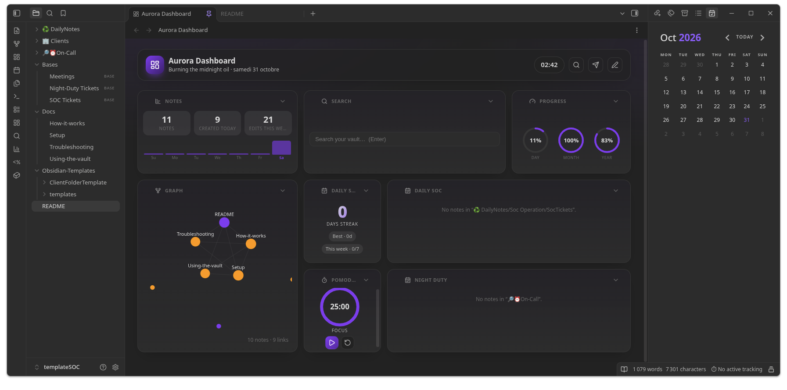
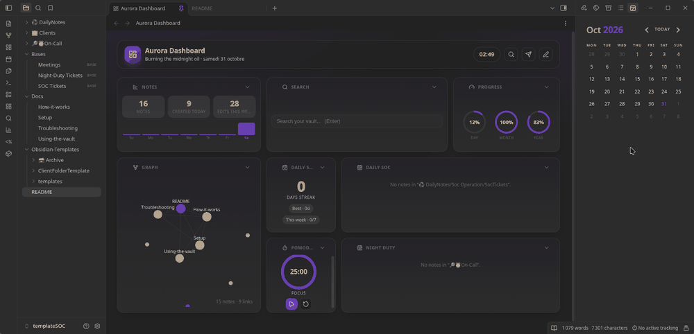
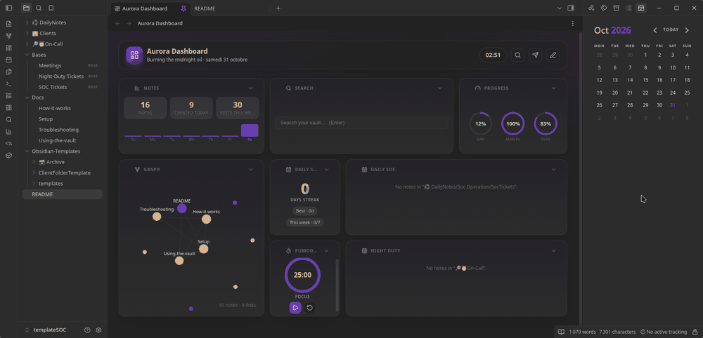
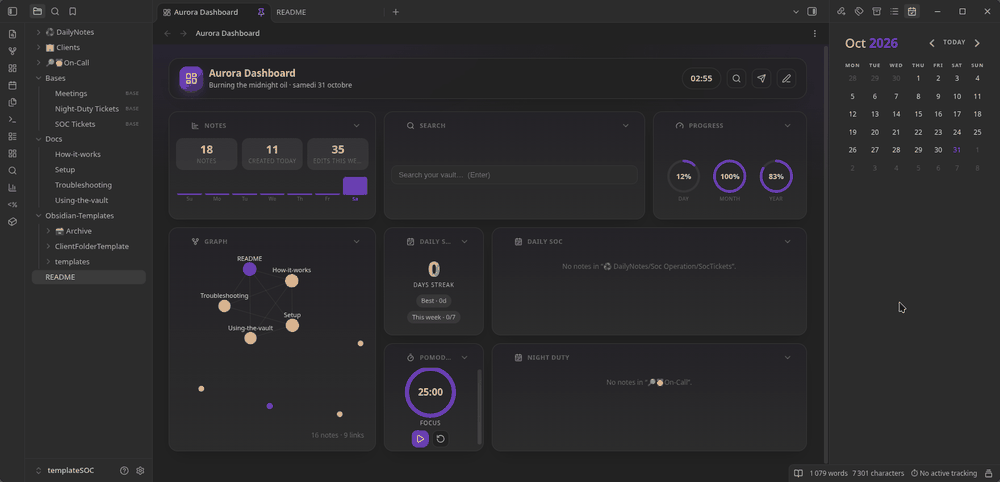

# SOC Template Vault for Obsidian

A ready-to-use [Obsidian](https://obsidian.md) vault for SOC analysts. Press one shortcut, answer three questions, and get a ticket note that is **named, filled in, tagged, filed in the right folder and timed**. Night-duty (on-call) notes and client meeting notes work the same way. A dashboard turns your tickets into year heatmaps, and three Bases list everything.

No coding needed to use it. Every template is plain text, with its settings at the top of the file.



## Features

- **3 templates** (Templater): SOC ticket, night-shift (on-call) ticket, client meeting.
- **Auto-filing and tagging**: notes land in dated folders (`year / month / day`) with a ticket ID, customer and category tags, and a typed `date` property.
- **Time tracking**: the timer starts when the note is created and stops when you tick the task (Task Time Tracker, one project per customer).
- **Customer matching**: `Acme Corp`, `acme_corp` and `ACME-corp` resolve to the same customer, with suggestions for near matches.
- **Dashboard**: vault graph plus SOC and on-call heatmaps that count tickets by the ID prefix you set in the templates.
- **3 Bases**: SOC tickets, on-call tickets, meetings (File name, Date, Type, Month, Client, Provider, Tags).
- **21 community plugins pre-installed and configured**; nothing to download from the plugin store.

## See it in action

**New SOC ticket**: `Ctrl/Cmd + S`, pick the template, answer the pop-ups, get the finished note.



**New night-duty (on-call) ticket**



**New client meeting**: type, provider, participants.



## Quick start

Requires [Obsidian](https://obsidian.md/download) 1.13 or newer (Windows, macOS, Linux).

1. **Download** this repository (**Code → Download ZIP**) and unzip it somewhere permanent.
2. In Obsidian choose **Open folder as vault** and select the folder. When asked, click **Trust author and enable plugins**. The Dashboard and the vault's own README (the full user manual) open on first launch.
3. **Set your ticket prefix** once. In `Obsidian-Templates/templates/`, open `- DailySOC tickets` and `- Night-shift-Duty` and change the line at the top:
   ```js
   const TICKET_PREFIX = "placeholder-ticket-id"   // e.g. "INC"
   ```
4. *(Optional)* In `- meeting`, replace the `REPLACEME-…` meeting types, providers and participants.
5. Press **`Ctrl + S`** (**`Cmd + S`** on macOS), pick a template, answer the pop-ups.

A ticket then looks like this (prefix `INC`):

```markdown
---
date: 2026-10-31T09:42:00
client: "Acme Corp"
Alert name: "Impossible travel detected"
tags:
  - "INC-1234"
  - "acme_corp"
  - "soc_operation"
---

- [ ] ⏱️ INC-1234 - Impossible travel detected - Acme Corp [tt-id:: AbC123xy]
```

followed by an investigation form and a draft customer reply.

## What is inside

```
Obsidian-Templates/templates/   the 3 working templates   <- edit these
Obsidian-Templates/ClientFolderTemplate/   folder set to copy for a new client
♻️ DailyNotes/                  daily notes; SOC tickets are filed under Soc Operation/SocTickets
🔎⏰On-Call/                     night-duty notes
🏢 Clients/📊 Monthly Meetings/  meeting notes
Bases/                          ticket, on-call and meeting tables
Docs/                           full documentation
.obsidian/                      settings and the bundled plugins
```

Ticket, on-call and meeting folders are created the first time a template needs them.

## Documentation

| | |
|---|---|
| [Setup](../Docs/Setup.md) | Step-by-step install, ticket prefix, meeting lists, first-run check, settings, glossary |
| [Using the vault](../Docs/Using-the-vault.md) | Daily workflows with examples, time tracking, dashboard, Bases |
| [How it works](../Docs/How-it-works.md) | Template pipeline, data model, matching and heatmap logic, what to change together |
| [Troubleshooting](../Docs/Troubleshooting.md) | Symptom, cause, fix |

## Notes

- **Full user manual.** The vault's own [`README.md`](../README.md) opens inside Obsidian on first launch; this page is the GitHub overview.
- **Templates are code.** Templater runs JavaScript with full access to your vault; read any template before running one you did not write.
- **The dashboard is a modified build** of [stef4678/aurora-dashboard](https://github.com/stef4678/aurora-dashboard), bundled as *Aurora Dashboard (SOC)* (source: [JE55II/custom_aurora-dashboard](https://github.com/JE55II/custom_aurora-dashboard)). It has its own plugin ID so the plugin store cannot overwrite it. Do not replace it with the original.
- **No account needed.** Obsidian Sync and Publish are off.

## License

The original content of this repository (templates, documentation, Bases, configuration) is dedicated to the public domain under [CC0 1.0 Universal](../LICENSE). Use, copy, modify and redistribute it freely, with no attribution required.

The bundled Obsidian plugins and CSS snippets are **not** covered by CC0. They keep their own licences (MIT, GPL-3.0, AGPL-3.0, MPL-2.0, Apache-2.0), listed with their sources in [THIRD-PARTY-NOTICES.md](../THIRD-PARTY-NOTICES.md).

## Author

Notes and research by the author: [Koffei](https://publish.obsidian.md/koffei/%F0%9F%93%A1Koffei/README) · [Daily CyberNews](https://publish.obsidian.md/koffei/%F0%9F%93%A1Koffei/Daily+CyberNews/%F0%9F%93%86+Daily+CyberNews+Index) · [Threat Actors](https://publish.obsidian.md/koffei/%F0%9F%93%A1Koffei/Articles/Threat-Actor+Mapping/%F0%9F%8E%AD+Threat+Actors+Index) · [CVE Report](https://publish.obsidian.md/koffei/%F0%9F%93%A1Koffei/Articles/CVE-Report/README) · [Report Samples](https://publish.obsidian.md/koffei/%F0%9F%93%A1Koffei/Report+Samples/Report+Samples) · [ThreatActor Map](https://je55ii.github.io/koffei-threat-map/)
